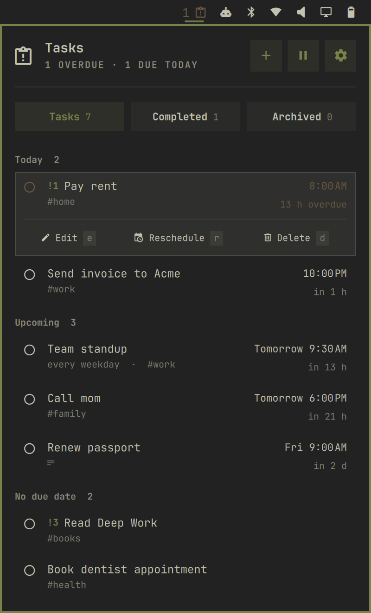
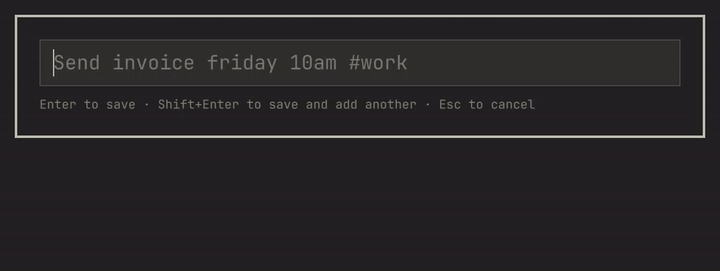
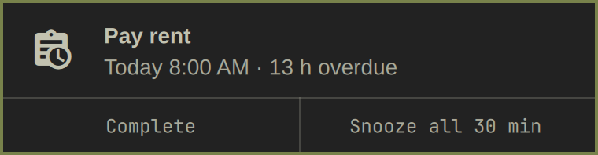
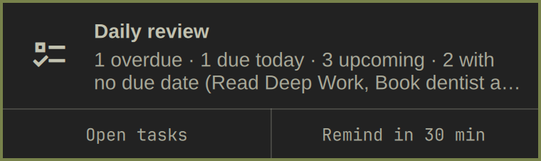
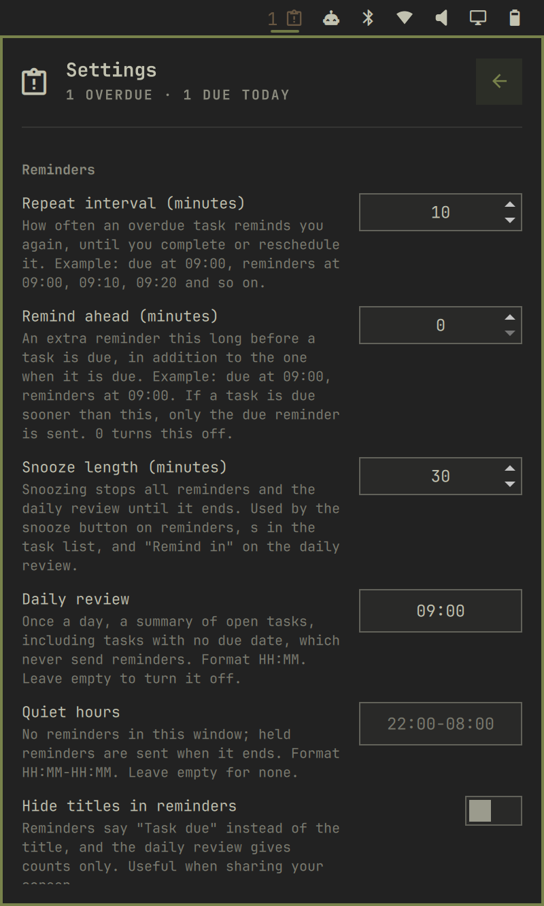

<div align="center">


<h1>Overdue</h1>

<p><strong>Tasks that nag you until they're done.</strong></p>

<p>A task list for the <a href="https://omarchy.org">Omarchy</a> desktop that lives in your bar,<br>
understands dates the way you say them, and keeps reminding you until you act.</p>

<p>
  <a href="https://github.com/canseyran/overdue/actions/workflows/tests.yml"></a>
  <a href="LICENSE"></a>
  
  
  
</p>

<p>
  <a href="#install">Install</a> ·
  <a href="#features">Features</a> ·
  <a href="#writing-tasks">Writing tasks</a> ·
  <a href="#keyboard-shortcuts">Shortcuts</a> ·
  <a href="#command-line">Command line</a> ·
  <a href="#faq">FAQ</a>
</p>



</div>

## Why Overdue?

Most to-do lists are passive. You write a task down, it sits quietly in an app
you don't open, and you find it again a week too late. Calendar reminders fire
once and are swiped away in a second.

Overdue takes the opposite approach:

- **Adding a task takes two seconds.** Press a key, type
  `pay rent friday 9am`, hit Enter. No date pickers, no forms.
- **It stays in sight.** The bar icon shows how many tasks are due today or
  overdue, and turns the urgent colour once something is late.
- **It doesn't let go.** A due task sends a reminder, and keeps sending it every
  few minutes until you complete it, reschedule it or snooze.
- **Nothing falls through the cracks.** Tasks without a date never remind you,
  so a daily review names them once a day.

Everything stays on your machine: one SQLite file, no account, no network.

## Features

### Quick add that understands you

Summon one line from anywhere and write the task the way you'd say it. A live
preview shows exactly what was understood before you save: date, repeat, tags,
priority and description.



### Reminders that keep coming back

When a task falls due you get a notification with **Complete** and **Snooze**
buttons. Ignore it and it comes back every 10 minutes (configurable), replacing
the previous card so they never pile up. Snooze pauses every reminder at once,
and do-not-disturb and quiet hours are respected.



### A daily review for everything else

Once a day Overdue sums up what's open and names the tasks that have no due
date, the ones nothing else would ever remind you about.



### A panel for keyboard and mouse alike

Left-click the bar icon for the task panel: **Tasks**, **Completed** and
**Archived** tabs, tasks grouped into Today, Upcoming and No due date, and the
selected task's actions right under it. Every action has a key, and every
button's tooltip tells you which.

### All the details

- **Natural-language dates:** `tomorrow 3pm`, `friday`, `in 2h`, `25 dec`,
  `end of month`, `every weekday 9:30`. Small typos like `tommorow` or
  `wednsday` are fine.
- **Repeating tasks:** completing one moves it to its next occurrence.
- **Tags, priorities and descriptions:** `#home`, `!1`, and everything after
  ` -- ` as a description.
- **Remind ahead:** an optional extra reminder before a task is due.
- **Quiet hours:** reminders wait until the window ends, then arrive.
- **Hide titles:** reminders say "Task due" instead of the title, for when you
  share your screen.
- **Survives sleep and restarts:** a missed reminder arrives when the machine
  wakes or the shell starts, and a snooze is remembered.
- **Lifecycle:** completed tasks move to Archived after 7 days and archived
  tasks are deleted after 30 (both configurable, or never).
- **Search** across titles, descriptions and tags.
- **Scriptable:** every action is available from the command line, with JSON
  output and export.
- **Follows your Omarchy theme**, and is built from the same parts as Omarchy's own panels.

## Install

Requires Omarchy 4.5 or newer.

```bash
omarchy plugin add https://github.com/canseyran/overdue --enable
```

Enabling puts the icon in the bar's right section and starts the service.
There's nothing to build and nothing else to install.

### Key bindings

Plugins can't register keys themselves, so add these to
`~/.config/hypr/bindings.lua` (both are free in Omarchy's defaults):

```lua
o.bind("SUPER + N",       "Overdue quick add", { panel = "canseyran.overdue" })
o.bind("SUPER + ALT + N", "Overdue tasks",     "omarchy-shell canseyran.overdue togglePanel")
```

| Open | Key | Mouse | Command |
|---|---|---|---|
| Quick add | <kbd>Super</kbd> <kbd>N</kbd> | Right-click the bar icon | `omarchy-shell shell summon canseyran.overdue '{}'` |
| Task panel | <kbd>Super</kbd> <kbd>Alt</kbd> <kbd>N</kbd> | Left-click the bar icon | `omarchy-shell canseyran.overdue togglePanel` |

<details>
<summary>Why the panel binding uses the plain command</summary>

`{ panel = ... }` is Omarchy's shorthand: it toggles the quick-add line, so a
second press closes it. The `{ ipc = ... }` shorthand splits its target at the
first dot, which breaks on `canseyran.overdue`, so the panel uses the plain
command. SUPER+SHIFT+T (Activity), SUPER+SHIFT+N (Editor) and SUPER+CTRL+N
(Network) are already taken by Omarchy.

</details>

## Writing tasks

Everything that isn't a date, a tag or an option stays in the title.
`call mom tomorrow 3pm #family !1` saves **call mom**, due tomorrow at 15:00,
tagged `family`, priority 1.

| You write | Meaning |
|---|---|
| `today`, `tonight`, `tomorrow`, `day after tomorrow` | Relative days |
| `monday`, `on fri`, `next friday`, `this weekend`, `next week`, `next month`, `next year` | Weekdays and periods (`next friday` is the Friday of next week) |
| `next march`, `in march` | The 1st of that month, the next time it comes round |
| `end of week` / `eow`, `end of month` / `eom`, `end of year` / `eoy` | Friday, the last day of the month, 31 December |
| `in 20m`, `in 2 hours`, `in half an hour`, `in 3 days` | Offsets |
| `3pm`, `15:00`, `3:30 pm`, `at 9`, `noon`, `midnight`, `at lunch` | Times (`at 1` to `at 6` mean the afternoon) |
| `tomorrow morning`, `this afternoon`, `friday evening` | Parts of the day (hours are configurable) |
| `25 dec`, `dec 25`, `25th of december`, `2026-12-25`, `25.12.`, `25.12.2027` | Dates (a past date without a year means next year) |
| `every day`, `every monday 9am`, `every 2 weeks`, `every other week`, `weekdays`, `monthly` | Repeats |
| `#tag`, `!1` `!2` `!3` | Tags and priority (`!1` is highest) |
| `"next monday"` | Quoted words are never read as a date |
| `call bank tomorrow -- ask about the fee` | Everything after ` -- ` is the description, kept as written |

A date without a time gets the default hour (09:00); if that has already passed
for `today`, it gets the next full hour. A time on its own that has already
passed today means tomorrow.

## Using the panel

- **Tasks** holds your open tasks, grouped into **Today** (overdue first), **Upcoming** and
  **No due date**, or as one list by due date if you turn grouping off.
- **Completed** holds finished tasks, which you can restore. After 7 days they move to Archived.
- **Archived** holds deleted tasks and old completed ones. They can be restored, and are
  deleted permanently after 30 days.

Each row shows the title with its repeat and tags, and on the right when it's
due and how far away that is ("Fri 09:00 / in 2 d", "14:00 / 25 min overdue").
Select a task to see its description and its actions.

Adding and editing use a small form with **Task**, **Due** and **Description**
boxes. A date typed in the Task box (`pay rent friday 9am`) fills the Due box as
you type; once you change the Due box by hand, it's left alone.

### Keyboard shortcuts

| Key | Action |
|---|---|
| <kbd>j</kbd> / <kbd>k</kbd>, <kbd>↓</kbd> / <kbd>↑</kbd> | Move |
| <kbd>Tab</kbd> / <kbd>Shift</kbd>+<kbd>Tab</kbd>, <kbd>h</kbd> / <kbd>l</kbd>, <kbd>←</kbd> / <kbd>→</kbd> | Previous / next tab |
| <kbd>Space</kbd> | Complete a task, or restore it from Completed or Archived |
| <kbd>e</kbd>, <kbd>Enter</kbd> | Edit |
| <kbd>r</kbd> | Reschedule (`tomorrow 9am`, `in 2h`, `none`) |
| <kbd>d</kbd>, <kbd>Delete</kbd> | Delete (moves to Archived; in Archived, press twice to delete permanently) |
| <kbd>a</kbd> | Add a task |
| <kbd>/</kbd> | Search titles, descriptions and `#tags` |
| <kbd>s</kbd> | Snooze all reminders; press again to resume |
| <kbd>,</kbd> | Settings |
| <kbd>Esc</kbd> | Step back: cancel a delete, leave settings, clear the search, then close |

In quick add, <kbd>Enter</kbd> saves and closes, <kbd>Shift</kbd>+<kbd>Enter</kbd>
saves and keeps the line open for the next task, and <kbd>Esc</kbd> clears the
line or closes it. In the edit form, <kbd>Ctrl</kbd>+<kbd>Enter</kbd> saves from
the Description box.

## Reminders and the daily review

- When a task falls due, a reminder goes out and repeats every *N* minutes until
  you complete or reschedule the task.
- **Snooze is app-wide.** The snooze button on a reminder, or <kbd>s</kbd> in the
  panel, pauses every reminder and the daily review, and closes open cards. The
  bar icon shows a crossed-out clipboard until it ends.
- **Remind ahead** (off by default) adds a reminder before the due time. If a
  task is due sooner than that, only the due reminder is sent.
- **Quiet hours** (e.g. `22:00-08:00`) hold reminders until the window ends.
- Reminders are ordinary notifications, so Omarchy's do-not-disturb silences them.
- Overdue tasks remind you as soon as the shell starts and after the machine
  wakes. The service listens to logind's sleep signal; it doesn't poll.

The **daily review** (09:00 by default) reads like *"2 overdue · 1 due today ·
5 with no due date (Pay rent, Call bank, Renew passport and 2 more)"*. **Open
tasks** opens the panel and **Remind in 30 min** asks again later. If nothing is
open, nothing is sent; if the machine was off at that time, it arrives when the
shell starts.

## Settings

Open the panel and press <kbd>,</kbd> (or click the gear). Every setting
explains itself with an example based on its current value. The same settings
appear in the bar's widget settings, and both stay in sync.

<details>
<summary>All settings and their defaults</summary>

<br>



| Setting | Default |
|---|---|
| Repeat interval (minutes) | 10 |
| Remind ahead (minutes, 0 = off) | 0 |
| Snooze length (minutes) | 30 |
| Hide titles in reminders | off |
| Daily review (empty = off) | 09:00 |
| Quiet hours (e.g. `22:00-08:00`, empty = none) | none |
| Hour for dates without a time | 9 |
| "morning" / "afternoon" / "evening" / "tonight" hours | 9 / 14 / 18 / 21 |
| "at 1" to "at 6" mean afternoon | on |
| First day of the week (for "next week", "next friday") | Monday |
| End of week (for "end of week", "eow") | Friday |
| Show count on the bar icon | on |
| Group tasks by due date | on |
| Archive completed tasks after (days, 0 = never) | 7 |
| Delete archived tasks after (days, 0 = never) | 30 |

From a terminal (the bar widget's stored values win when it loads):

```bash
omarchy-shell canseyran.overdue setSetting quietHours "22:00-08:00"
omarchy-shell canseyran.overdue settings
```

</details>

## Command line

Every action is available over IPC, which makes Overdue easy to script.

```bash
omarchy-shell canseyran.overdue add "pay rent friday 9am #home"
omarchy-shell canseyran.overdue list            # open tasks as JSON
omarchy-shell canseyran.overdue done 12
```

<details>
<summary>All commands</summary>

```bash
omarchy-shell canseyran.overdue add "pay rent friday 9am #home"
omarchy-shell canseyran.overdue list                                # open tasks as JSON
omarchy-shell canseyran.overdue done 12
omarchy-shell canseyran.overdue snooze 30                           # snooze all reminders for 30 minutes
omarchy-shell canseyran.overdue resume
omarchy-shell canseyran.overdue restore 12                          # from Completed or Archived
omarchy-shell canseyran.overdue archive 12
omarchy-shell canseyran.overdue edit 12 "pay rent saturday 10am"
omarchy-shell canseyran.overdue reschedule 12 "in 2h"               # or "none"
omarchy-shell canseyran.overdue describe 12 "ask about the fee"     # "" removes it
omarchy-shell canseyran.overdue remove 12
omarchy-shell canseyran.overdue parse "standup every weekday 9:30"  # dry run
omarchy-shell canseyran.overdue exportJson > overdue-backup.json
omarchy-shell canseyran.overdue status
omarchy-shell canseyran.overdue togglePanel
omarchy-shell canseyran.overdue openPanel
omarchy-shell canseyran.overdue review                              # send the daily review now
omarchy-shell canseyran.overdue quickAdd
```

Export is called `exportJson` because `export` is a reserved word in QML.

</details>

## Your data

Tasks are stored locally in SQLite through Qt's LocalStorage, in the shell's
offline storage folder:

```
~/.local/share/quickshell/QML/OfflineStorage/Databases/1ffadc2eda451d159cd6b8402db895a0.sqlite
```

The file name is the MD5 of the database name `canseyran.overdue`. Back it up by
copying the file, or with `exportJson`. Overdue makes no network requests.

## FAQ

**Does it work with a replacement bar?**
Quick add, reminders and the command line keep working, but the bar icon
needs Omarchy's built-in bar to reach the service, and shows as unavailable
under a replacement bar.

**I changed the code and nothing happened.**
The service is kept loaded and isn't hot-reloaded. Run `omarchy restart shell`.

**Which languages are supported?**
English, both for date phrases and for the interface. Interface strings live in
`i18n/en.json`, so another language is one more catalog file next to it.

**Which Omarchy versions does it support?**
It's tested on Omarchy 4.5 (plugin `schemaVersion: 1`). The plugin API may
change between releases; `omarchy plugin validate .` checks a copy against your
version.

## Development

```bash
node --test tests/*.test.js   # or: bun test tests/
omarchy plugin validate .
```

| File | Role |
|---|---|
| `Parser.js` | Natural-language date parser (pure JavaScript, unit-tested) |
| `Model.js` | Settings, task sections, reminder planning, quiet hours, notification text safety (pure JavaScript, unit-tested) |
| `Store.js` | SQLite storage and migrations |
| `Service.qml` | Owns the tasks, the reminder scheduler and the IPC commands |
| `BarWidget.qml`, `TaskPanel.qml`, `SettingsView.qml`, `QuickAdd.qml` | The UI, which only binds to the service |

`Model.SETTINGS` is the single list of settings; `tests/manifest.test.js` checks
that the widget schema in `manifest.json` and the strings in `i18n/en.json`
agree with it.

GitHub Actions runs the tests on Node 22 and 26 and checks `manifest.json` on
every push and pull request. Issues and pull requests are welcome; please also
run `omarchy plugin validate .` locally before opening one.

## How it was made

Overdue was designed and directed by me, and most of its code was written
together with [Claude Code](https://claude.com/claude-code), Anthropic's AI
coding assistant. Every feature was tried out on a real Omarchy desktop, and the
date parser and the reminder logic are covered by unit tests that run on every
change. If something doesn't work the way you expect, please
[open an issue](https://github.com/canseyran/overdue/issues).

## License

[MIT](LICENSE) © canseyran

Icons are from [Material Design Icons](https://pictogrammers.com/library/mdi/),
via the Nerd Font that Omarchy ships.
